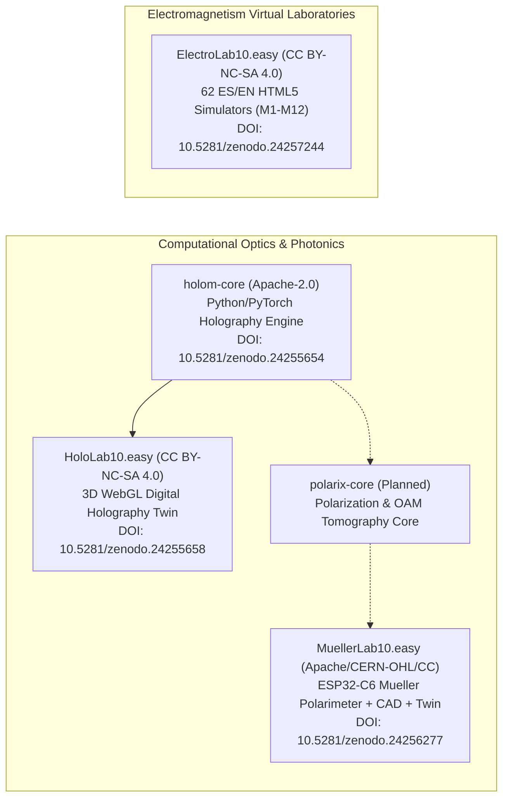

# 10.Easy & Research Ecosystem Map (`dudbilopr`)

**Owner:** Dudbil Olvasada Pabón Riaño · ORCID [`0000-0001-7239-3497`](https://orcid.org/0000-0001-7239-3497)

This directory links Dudbil Pabón's active public repositories, live web portals, software libraries, instrumentation hardware, and persistent Zenodo DOIs.

---

## Architecture Overview

---

## Live Zenodo-Archived Repositories

| Project | Domain | Live Site / Docs | Concept DOI (All Versions) | Version DOI | License |
| :--- | :--- | :--- | :--- | :--- | :--- |
| [**`holom-core`**](https://github.com/dudbilopr/holom-core) | Python / PyTorch Digital Holography | [MkDocs](https://dudbilopr.github.io/holom-core/) | [`10.5281/zenodo.24255654`](https://doi.org/10.5281/zenodo.24255654) | `v0.3.0`: [`10.5281/zenodo.24255655`](https://zenodo.org/records/24255655) | `Apache-2.0` |
| [**`hololab-10easy`**](https://github.com/dudbilopr/hololab-10easy) | 3D WebGL Holography Lab | [Live Lab](https://dudbilopr.github.io/hololab-10easy/) | [`10.5281/zenodo.24255658`](https://doi.org/10.5281/zenodo.24255658) | `v1.0.0`: [`10.5281/zenodo.24255659`](https://zenodo.org/records/24255659) | `CC BY-NC-SA 4.0` |
| [**`muellerlab-10easy`**](https://github.com/dudbilopr/muellerlab-10easy) | Portable ESP32-C6 Mueller Polarimeter | [Digital Twin](https://dudbilopr.github.io/muellerlab-10easy/) | [`10.5281/zenodo.24256277`](https://doi.org/10.5281/zenodo.24256277) | `v1.0.0`: [`10.5281/zenodo.24256278`](https://zenodo.org/records/24256278) | `Apache-2.0` / `CERN-OHL-S v2` / `CC BY-NC-SA 4.0` |
| [**`electrolab-10easy`**](https://github.com/dudbilopr/electrolab-10easy) | 62 Bilingual EM Simulators (`M1`–`M12`) | [Bilingual Portal](https://dudbilopr.github.io/electrolab-10easy/) | [`10.5281/zenodo.24257244`](https://doi.org/10.5281/zenodo.24257244) | `v1.0.0`: [`10.5281/zenodo.24257245`](https://zenodo.org/records/24257245) | `CC BY-NC-SA 4.0` / `Apache-2.0` |

---

## Versioning & Authorship Governance
- **Persistent Concept DOIs:** Each repository resolves to a single stable Concept DOI across future releases (`v1.1.0+`, `v2.0.0`).
- **Co-author Policy:** Collaborators and students are added to `CITATION.cff` and `.zenodo.json` strictly on tagged minor/major updates once their deliverables pass verification.
- **Validation Roadmaps:** Software packages include automated `pytest` CI; educational suites track physical invariant checks (e.g., `electrolab-10easy/VALIDATION_MATRIX.md`).
